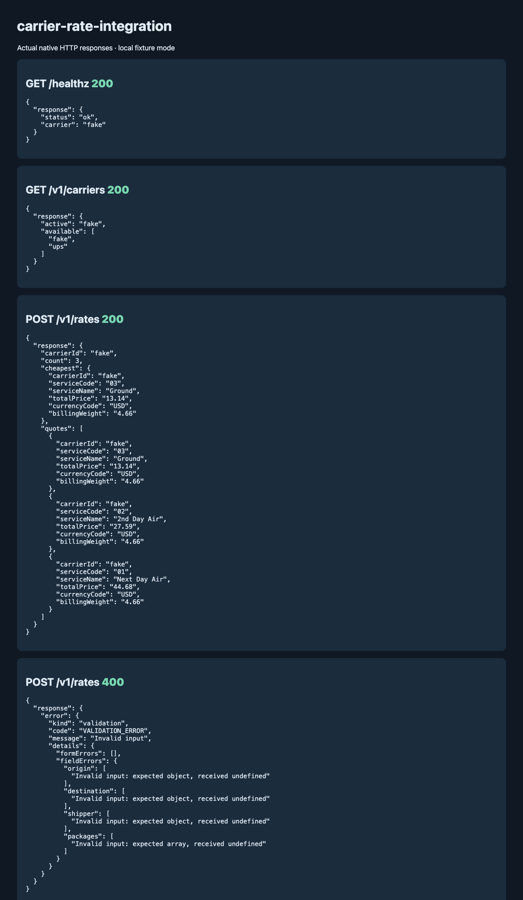
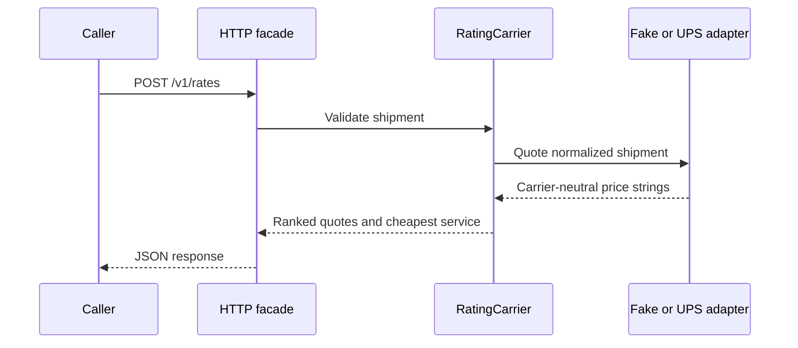

# carrier-rate-integration

A TypeScript service that asks a shipping carrier for rate quotes and returns them in a single, carrier-neutral format. It currently supports UPS (OAuth client credentials plus the Rating `Shop` endpoint) and a built-in `fake` carrier that prices shipments locally, so you can run and test everything without a UPS account.

## Quick start

```bash
npm install
CARRIER_ID=fake npm start

curl -s -X POST http://127.0.0.1:7121/v1/rates \
  -H 'Content-Type: application/json' \
  -d @examples/rate-request.json
```

The response looks like `{ carrierId, count, cheapest, quotes }`. Each quote has `serviceCode`, `serviceName`, `totalPrice`, `currencyCode` and `billingWeight`. Prices are kept as strings the whole way through to avoid float rounding.

Endpoints:

- `GET /healthz`
- `GET /v1/carriers` lists the registered carriers
- `POST /v1/rates` returns quotes for a shipment

The HTTP layer is plain `node:http` with no framework. You can also skip HTTP and use it as a library: `createCarrierFromEnv(process.env)` returns the configured carrier, and `getRates(input)` returns its quotes.

## Using real UPS

Set `CARRIER_ID=ups` and provide the UPS variables from `.env.example` (`UPS_CLIENT_ID`, `UPS_CLIENT_SECRET`, `UPS_API_BASE_URL`, `UPS_OAUTH_TOKEN_URL`, and optionally `UPS_ACCOUNT_NUMBER`). The defaults point at the UPS CIE sandbox, not production. The app reads from `process.env`, so export the variables in your shell or run it through Docker Compose, which picks up `.env`.

Some details of the UPS adapter:

- The OAuth token is cached until shortly before it expires, and concurrent requests share one token fetch.
- A 401 from the rating call invalidates the token and retries once.
- 429, 5xx and network errors are retried with exponential backoff, and `Retry-After` is respected. Other 4xx responses are not retried.
- Shipments without a price in the response are dropped instead of being reported as free.

Errors are returned as a `CarrierError` with a `kind` (`validation`, `rate_limit`, `auth`, `upstream`, `parse`, `timeout`, `config`), which the HTTP layer maps to a status code. Only `validation` returns a 400.

## Adding another carrier

Extend `BaseRatingCarrier` from `src/rating-carrier.ts`, implement `quote(request)`, and register it:

```ts
registerCarrier("fedex", (ctx) => new FedExRatingCarrier(ctx));
```

Input validation (zod) runs in the base class, so adapters don't repeat it. `src/fake/carrier.ts` is a simple example to copy from. Its prices are made up and are not real UPS tariffs.

## Development

```bash
npm run verify          # lint, typecheck, tests
npm run test:coverage
```

Tests use Vitest. UPS calls go through an injected `fetch` against the fixtures in `test/fixtures/`, so nothing hits the network.

To run in a container (defaults to the fake carrier):

```bash
docker compose up --build
curl -s http://127.0.0.1:7121/healthz
```

## Scope

Only rate shopping is implemented. Labels, tracking, voiding and negotiated rates are not, and the service has no auth of its own since it's meant to sit behind an internal caller.

## Verified native example



The native run uses the fake carrier, with invented rates; it checks quote shopping and invalid-request rejection. No UPS request was sent.
[Captured responses](docs/native-api.json) use disposable fixture data.

The local suite, TypeScript build, and production dependency audit were rerun
on Node 22. Docker execution remains unverified in this environment.



## Author

[**Muhammad Nadeem**](https://github.com/dev-mnadeem)
