# carrier-rate-integration

A TypeScript service that asks a shipping carrier for rate quotes and returns them in one carrier-neutral shape. It supports UPS (OAuth client credentials plus the Rating API) and a built-in `fake` carrier that prices shipments locally, so you can run, test and integrate against it without a UPS account.

The point is to keep carrier quirks in one adapter. A checkout or fulfilment service sends the same request for every carrier and gets back the same quote shape, with errors already classified into a small, stable set of kinds.

## How it fits together

```mermaid
flowchart LR
    client[Internal caller] -->|POST /v1/rates| http[node:http server<br/>src/server]
    http --> handle[handle&#40;&#41;<br/>routing + error mapping]
    handle --> port[RatingCarrier port<br/>zod validation]
    port --> fake[FakeRatingCarrier<br/>local pricing model]
    port --> ups[UpsRatingCarrier]
    ups --> tokens[UpsTokenCache<br/>OAuth client credentials]
    ups --> client2[HttpClient<br/>timeout + retry/backoff]
    tokens --> client2
    client2 -->|HTTPS| upsapi[(UPS Rating API)]
```



`CARRIER_ID` picks which adapter the registry builds at startup. UPS credentials are read only when the UPS adapter is the one being built, so the fake carrier boots with no UPS variables at all.

## Quick start

With Docker (defaults to the fake carrier):

```bash
docker compose up --build
curl -s http://127.0.0.1:7121/healthz
```

Or with Node 22 (`.nvmrc` pins it):

```bash
npm install
CARRIER_ID=fake npm start
```

Then request rates for the sample shipment in `examples/`:

```bash
curl -s -X POST http://127.0.0.1:7121/v1/rates \
  -H 'Content-Type: application/json' \
  -d @examples/rate-request.json
```

## API

| Method | Path           | Purpose                                     |
| ------ | -------------- | ------------------------------------------- |
| GET    | `/healthz`     | Liveness, plus the active carrier id        |
| GET    | `/v1/carriers` | The active carrier and every registered one |
| POST   | `/v1/rates`    | Quotes for a shipment                       |

The responses below were captured from the Docker Compose stack running the fake carrier.

`GET /v1/carriers`

```json
{ "active": "fake", "available": ["fake", "ups"] }
```

`POST /v1/rates` with `examples/rate-request.json` (one 4.5 lb box, 12 x 9 x 6 in, Maryland to Georgia):

```json
{
  "carrierId": "fake",
  "count": 3,
  "cheapest": {
    "carrierId": "fake",
    "serviceCode": "03",
    "serviceName": "Ground",
    "totalPrice": "13.14",
    "currencyCode": "USD",
    "billingWeight": "4.66"
  },
  "quotes": [
    {
      "carrierId": "fake",
      "serviceCode": "03",
      "serviceName": "Ground",
      "totalPrice": "13.14",
      "currencyCode": "USD",
      "billingWeight": "4.66"
    },
    {
      "carrierId": "fake",
      "serviceCode": "02",
      "serviceName": "2nd Day Air",
      "totalPrice": "27.59",
      "currencyCode": "USD",
      "billingWeight": "4.66"
    },
    {
      "carrierId": "fake",
      "serviceCode": "01",
      "serviceName": "Next Day Air",
      "totalPrice": "44.68",
      "currencyCode": "USD",
      "billingWeight": "4.66"
    }
  ]
}
```

The billing weight is 4.66 rather than 4.5 because the box's dimensional weight (12 x 9 x 6 / 139) is higher than its actual weight. Adding `"serviceCode": "02"` to the request narrows the answer to that one service.

Prices stay strings from the carrier response to the client, so no float rounding creeps in.

An invalid request is a 400 with zod's field errors:

```json
{
  "error": {
    "kind": "validation",
    "code": "VALIDATION_ERROR",
    "message": "Invalid input",
    "details": {
      "formErrors": [],
      "fieldErrors": {
        "destination": ["Invalid input: expected object, received undefined"],
        "packages": ["Invalid input: expected array, received undefined"]
      }
    }
  }
}
```

(trimmed: the real response also lists `origin` and `shipper`.)

### Errors

Every failure is a `CarrierError` with a `kind`, and the HTTP layer maps the kind to a status. Only `validation` is the caller's fault; the rest describe something between this service and the carrier, so they are 5xx even when UPS itself answered 4xx.

| kind         | HTTP | Raised when                                                  |
| ------------ | ---- | ------------------------------------------------------------ |
| `validation` | 400  | The rate request fails the schema                            |
| `rate_limit` | 429  | UPS kept answering 429 after the retry budget                |
| `auth`       | 502  | The OAuth token request fails, or a refreshed token gets 401 |
| `upstream`   | 502  | Any other non-2xx from UPS, or a network failure             |
| `parse`      | 502  | UPS answered 2xx with a body that is not the expected shape  |
| `timeout`    | 504  | A call ran past `REQUEST_TIMEOUT_MS`                         |
| `config`     | 500  | Missing or invalid configuration                             |

Malformed JSON gets `400 INVALID_JSON`, and a body over 256 KB gets `413 BODY_TOO_LARGE`.

## Using real UPS

Set `CARRIER_ID=ups` and provide the UPS variables from `.env.example` (`UPS_CLIENT_ID`, `UPS_CLIENT_SECRET`, `UPS_API_BASE_URL`, `UPS_OAUTH_TOKEN_URL`, and optionally `UPS_ACCOUNT_NUMBER`). The example values point at the UPS CIE sandbox, not production. The app reads `process.env` only, so export the variables in your shell, or copy `.env.example` to `.env` and use Docker Compose, which substitutes them into the container.

Note that `CARRIER_ID` defaults to `ups` when it is not set at all, so a production deployment cannot silently fall back to made-up prices. The Compose file and `.env.example` set it to `fake`.

How the UPS adapter behaves:

- Without a `serviceCode` it sends `RequestOption: "Shop"` to `/rating/{version}/shop` and returns every service UPS prices. With one, it sends `"Rate"` to `/rating/{version}/rate`, because UPS ignores the requested service under Shop.
- The OAuth token is cached until `TOKEN_SKEW_MS` before it expires, and concurrent cold-start requests share one token fetch.
- A 401 from the rating call drops the token and retries once with a fresh one.
- 429, 5xx and network errors are retried with exponential backoff up to `MAX_RETRY_ATTEMPTS`, and `Retry-After` wins when UPS sends it. Other 4xx responses and timeouts are not retried.
- A rated shipment with no `TotalCharges` is dropped instead of being reported as free. If nothing priced is left, the call fails with `parse`.
- The account number on the request wins over `UPS_ACCOUNT_NUMBER`; a blank one counts as absent. With no account at all, it asks for published rates without a `BillShipper` block.

## Using it as a library

You can skip HTTP: `createCarrierFromEnv(process.env)` returns the configured carrier, and `carrier.getRates(input)` validates the input and returns its quotes. `createUpsRatingCarrier(config, { fetchImpl })` takes an injected `fetch`, which is how the tests drive UPS without a network.

## Adding another carrier

Extend `BaseRatingCarrier` from `src/rating-carrier.ts`, implement `quote(request)`, and register it:

```ts
registerCarrier("fedex", (ctx) => new FedExRatingCarrier(ctx));
```

Input validation runs in the base class, so adapters don't repeat it. `src/fake/carrier.ts` is a short example to copy from. Its prices come from a simple zone-and-weight model and are not real UPS tariffs.

## Development

```bash
npm run verify          # lint, typecheck, tests
npm run test:coverage
npm run format:check
```

Tests use Vitest. UPS calls go through an injected `fetch` that serves the recorded payloads in `test/fixtures/`, so the suite never touches the network or needs credentials. The HTTP facade is tested both as a pure `handle()` function and over a real socket on an ephemeral port.

## Scope

Only rating is implemented. Labels, tracking, voiding and negotiated rates are not, and the service has no authentication of its own because it is meant to sit behind an internal caller.

## License

MIT, see [LICENSE](LICENSE).
